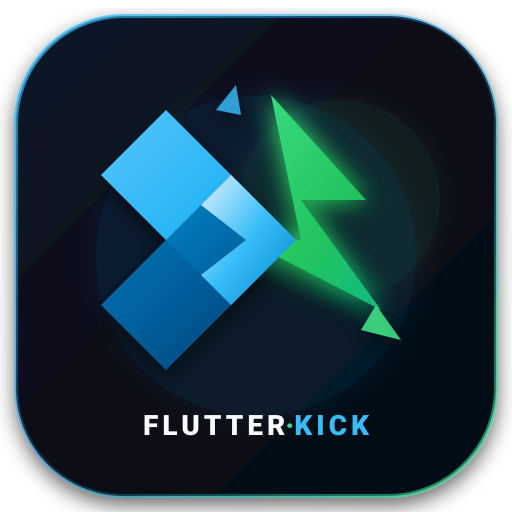

<p align="center">
  
</p>

<h1 align="center">Flutter-Kick — Install Flutter & Android SDK Without Android Studio</h1>

<p align="center">
  <a href="https://github.com/frozenlabx/flutter-kick/actions/workflows/ci.yml"></a>
  <a href="https://www.gnu.org/software/bash/"></a>
  <a href="https://microsoft.com/powershell"></a>
  <a href="#supported-platforms"></a>
  <a href="LICENSE"></a>
</p>

Flutter-Kick is an open-source Flutter and Android SDK installer that automatically sets up a complete, headless Flutter development environment without Android Studio.

Install Flutter SDK, Android SDK command-line tools, Java JDK, Gradle, Android NDK, and CMake on Windows, macOS, or Linux using a single installation command.

Built for Flutter developers, CI/CD pipelines, and lightweight Android development environments, Flutter-Kick simplifies installation, environment configuration, verification, and uninstallation.

---

## ⚡ Quick Start (No Git Clone Required)

Run the one-liner in your terminal to start the interactive setup:

### macOS & Linux
```bash
curl -fsSL https://raw.githubusercontent.com/frozenlabx/flutter-kick/main/install.sh | bash
```
> **Non-Interactive LTS Installation**:
> ```bash
> curl -fsSL https://raw.githubusercontent.com/frozenlabx/flutter-kick/main/install.sh | bash -s -- --default
> ```

### Windows (PowerShell)
```powershell
irm https://raw.githubusercontent.com/frozenlabx/flutter-kick/main/install.ps1 | iex
```
> **Non-Interactive LTS Installation**:
> ```powershell
> & ([scriptblock]::Create((irm https://raw.githubusercontent.com/frozenlabx/flutter-kick/main/install.ps1))) -Default
> ```

---

## ✨ Features

- **Headless & Fast**: Downloads only command-line tools, platforms, build-tools, NDK, CMake, Gradle, and Flutter. Zero Android Studio GUI overhead.
- **Smart Tool Detection & Reuse**: Intelligently identifies existing JDK (17/21), Android SDK/cmdline-tools, Gradle, and Flutter installations—reusing them seamlessly without redundant downloads.
- **Diagnostic Doctor & Auto-Fix**: Comprehensive diagnostic analyzer (`--doctor` / `-Doctor`) that inspects your entire mobile toolchain and provides actionable recommendations and automated fixes (`--fix` / `-Fix`).
- **Concurrent Ingestion & Live Progress**: Downloads JDK, Android cmdline-tools, Gradle, and Flutter simultaneously with real-time percentage indicators.
- **Smart NDK Resolution**: Supports partial versions (e.g. `28.0`, `27.2`), auto-mapping to the full LTS revision (e.g. `28.0.13004108`).
- **Multi-API Support**: Install multiple Android SDK platforms at once (e.g. `--api 34,35,36`).
- **Idempotent Shell Configuration**: Safely manages `JAVA_HOME`, `ANDROID_HOME`, `GRADLE_HOME`, and `PATH` via clean, reversible marker blocks (`.zshrc`, `.bashrc`, `config.fish`, or Windows User Environment).
- **Automated Verification**: Automatically validates `java`, `gradle`, `adb`, and verifies Flutter licenses via `flutter doctor`.
- **Clean Uninstallation**: Reverts environment variable blocks and cleanly removes installed SDK directories.

---

## 🩺 Diagnostic Doctor & Troubleshooting

Analyze your mobile development setup and verify toolchain health at any time:

### Without Cloning (One-Liner from Anywhere)
```bash
# macOS & Linux
curl -fsSL https://raw.githubusercontent.com/frozenlabx/flutter-kick/main/install.sh | bash -s -- --doctor

# Windows (PowerShell)
& ([scriptblock]::Create((irm https://raw.githubusercontent.com/frozenlabx/flutter-kick/main/install.ps1))) -Doctor
```

### From Local Cloned Repository
```bash
# macOS & Linux
cd flutter-kick
./install.sh --doctor

# Automatically repair detected issues (licenses, Flutter SDK, PATH)
./install.sh --doctor --fix
```

```powershell
# Windows (PowerShell)
cd flutter-kick
.\install.ps1 -Doctor

# Automatically repair detected issues
.\install.ps1 -Doctor -Fix
```

---

## ⚙️ Components & Default Versions

Accepted via `[1] Recommended LTS` or customized in `[2] Custom Setup`:

| Component | Default | Popular Options | Notes |
| :--- | :--- | :--- | :--- |
| **JDK** | `17` | `17`, `21` | Eclipse Temurin OpenJDK |
| **Android API** | `36` | `36` (Android 16), `35`, `34` | Comma-separated supported (e.g. `34,35,36`) |
| **Build-Tools** | `36.0.0` | `36.0.0`, `35.0.0`, `34.0.0` | Matches target Android API |
| **Android NDK** | `27.2.12479018` | `28.0`, `27.2`, `26.3`, `skip` | Auto-resolves partial version strings |
| **CMake** | `3.22.1` | `3.22.1`, `3.28.0`, `skip` | AGP compatible C/C++ build tool |
| **Gradle** | `8.11.1` | `8.11.1`, `8.10.2`, `skip` | Official Gradle release |
| **Flutter SDK** | `stable` | `stable`, `beta`, `master`, `fvm` | FVM mode supported |

---

## 🚀 CLI Flags & Automation

Automate CI/CD pipelines or bypass prompts with command-line flags:

### Unix (macOS / Linux)
```bash
# Non-interactive default setup (reuses existing valid tools)
./install.sh --default

# Force fresh downloads even if tools exist
./install.sh --default --reinstall

# Custom toolchain configuration
./install.sh --jdk 21 --api "34,35" --ndk 28.0 --gradle 8.11.1 --flutter beta --yes

# Diagnose environment & toolchain health
./install.sh --doctor

# Dry-run simulation (preview actions without writing to disk)
./install.sh --dry-run --default

# Clean uninstallation
./install.sh --uninstall --yes
```

### Windows (PowerShell)
```powershell
# Non-interactive default setup (reuses existing valid tools)
.\install.ps1 -Default

# Force fresh downloads even if tools exist
.\install.ps1 -Default -Reinstall

# Custom toolchain configuration
.\install.ps1 -Jdk 21 -Api "34,35" -Ndk "28.0" -Gradle "8.11.1" -Flutter "beta" -Yes

# Diagnose environment & toolchain health
.\install.ps1 -Doctor

# Dry-run simulation
.\install.ps1 -DryRun -Default

# Clean uninstallation
.\install.ps1 -Uninstall -Yes
```

---

## Frequently Asked Questions

### Can I install Flutter without Android Studio?

Yes. Flutter-Kick sets up Flutter and the Android
command-line development tools without installing
the Android Studio IDE.

### Does Flutter-Kick support Windows, macOS, and Linux?

Yes. Flutter-Kick provides Bash and PowerShell
installers for its supported operating systems.

### Can I install multiple Android SDK versions?

Yes. Use the `--api` option to specify multiple
Android API levels.

### Can Flutter-Kick be used in CI/CD pipelines?

Flutter-Kick supports non-interactive installation,
making it suitable for automated environments.

### How do I uninstall Flutter-Kick?

Use the installer's uninstall command to remove
managed components and revert its environment settings.

## 🖥️ Supported Platforms

| Platform | Family | Package Manager | Architectures |
| :--- | :--- | :--- | :--- |
| **macOS** | Darwin | Homebrew | `arm64` (Apple Silicon), `x86_64` (Intel) |
| **Ubuntu / Debian** | Debian | `apt-get` | `x86_64`, `arm64` |
| **Fedora / RHEL** | Fedora | `dnf` | `x86_64`, `arm64` |
| **Arch / Manjaro** | Arch | `pacman` | `x86_64`, `arm64` |
| **Windows** | Windows 10/11 | PowerShell 5.1+ / 7+ | `x64`, `ARM64` |

---

## 🧪 Testing

Run the automated test suite locally:

```bash
./tests/test_suite.sh
```

Validates configuration defaults, OS detection, idempotent environment injections, smart NDK mapping, interactive menus, and post-installation verification across 80 test cases.

---

## 📄 License

MIT © [FrozenLabX](https://github.com/frozenlabx)
